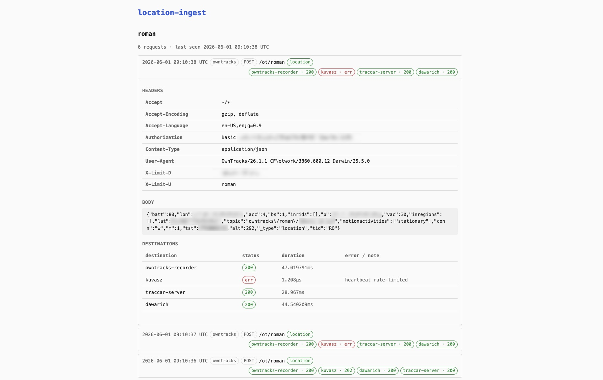

# Location Ingest

Deploy a unified location ingesting service that relays location data sent from individual apps or clients to multiple sources.

**Mix-and-match any location recording client with any server.**

> [!NOTE]
> This project is primarily developed on [Codeberg](https://codeberg.org/romanzipp/location-ingest) and only mirrored to GitHub. Please open issues and pull requests on Codeberg.

## Supported Clients

- [Owntracks](https://owntracks.org/booklet/guide/apps/)
- [Traccar Client](https://www.traccar.org/client/)

## Supported Servers

- [Owntracks Recorder](https://github.com/owntracks/recorder)
- [Traccar Server](https://www.traccar.org/server/)
- [Dawarich](https://dawarich.app/)
- Any heartbeat or push monitor that accepts an HTTP request, like Uptime Kuma or Kuvasz

## How it works

You point your tracking app at the ingest service. The service forwards each location update to every server you have configured for that client. One of those servers is marked as the primary, its reply is what the app sees.

Heartbeats only fire when an actual location was received, so a dead-man timer triggers as soon as your phone stops reporting.

## Web UI

The service ships with an optional dashboard at `/webui` that lists every recent request with its headers, body and per-destination relay status. It runs from memory only, no database. Toggle with `web.enabled` in the config.



## Install

Pull the image from GHCR:

```
docker pull ghcr.io/romanzipp/location-ingest:latest
```

Or run locally:

```
make run
```

A Helm chart lives under `deploy/helm/location-ingest`. The config is rendered into a ConfigMap from `.Values.config`, and credentials can be injected from a Kubernetes Secret via `.Values.envFromSecret.name`.

## Configuration

```yaml
server:
  listen: ":8080"

web:
  enabled: true
  max_requests_per_client: 500

clients:
  - name: roman
    sources:
      - kind: owntracks
        path: /ot/roman
        primary: owntracks-recorder

      - kind: traccar
        path: /tr/roman
        primary: traccar-server

    destinations:
      owntracks-recorder:
        username: roman
        device: phone
        basic_auth:
          user: roman
          password: ${OWNTRACKS_PASSWORD}

      traccar-server:
        device_id: "12345678"

      dawarich:
        api_key: ${DAWARICH_API_KEY}

      kuma:

destinations:
  - name: owntracks-recorder
    kind: owntracks_recorder
    url: https://recorder.example.com/pub

  - name: traccar-server
    kind: traccar_osmand
    url: https://traccar.example.com

  - name: dawarich
    kind: dawarich
    url: https://dawarich.example.com/api/v1/owntracks/points

  - name: kuma
    kind: heartbeat
    method: GET
    url: https://uptime.example.com/api/push/XXXX
    min_interval: 60s
```

### Per-client destination overrides

Each client lists the destinations it should fan out to as a map keyed by destination name. The value carries identity and credentials sent to that destination. Use an empty value (`kuma:` or `kuma: {}`) when the destination needs no overrides.

#### `owntracks_recorder`

Sent to an Owntracks Recorder.

* `username` (required), forwarded as `?u=` and `X-Limit-U`
* `device` (required), forwarded as `?d=` and `X-Limit-D`
* `basic_auth.user` and `basic_auth.password` (optional), sent as HTTP Basic auth

Username and device are required even if your client only uses the Traccar source, because cross-protocol fan-out still needs an identity to send.

#### `traccar_osmand`

Sent to a Traccar server speaking the OsmAnd protocol on port 5055.

* `device_id` (required), the numeric device id registered on your Traccar server, forwarded as `?id=`

The device id is required even if your client only uses the Owntracks source, because the Owntracks payload contains no Traccar id.

#### `dawarich`

Sent to a [Dawarich](https://dawarich.app/) instance via its OwnTracks-compatible endpoint. The URL must point at `/api/v1/owntracks/points` on your Dawarich host.

* `api_key` (required), the 32-character API key from your Dawarich account settings, sent as `?api_key=`
* `tid` (optional), a short identifier shown next to points in the Dawarich UI. Defaults to whatever the source app provided.

Works for both OwnTracks and Traccar sources. The parsed location is serialized as an OwnTracks payload before sending.

#### `heartbeat`

Sent to a generic push endpoint. Takes no per-client fields. Only fires when an actual location was parsed from the inbound request.

### Sources

Each source defines one inbound endpoint and the protocol it speaks.

* `kind`: `owntracks` or `traccar`
* `path`: the HTTP path the app posts to, must start with `/` and be canonical
* `primary`: name of the destination whose response is proxied back to the app, must be one of this client's destinations

### Environment variables

Any `${VAR}` placeholder in the config file is substituted at load time. The service refuses to start if a referenced variable is unset, so credentials cannot silently end up as empty strings.

## Runtime flags and env

* `--config <path>` path to YAML config, defaults to `config.yaml`
* `--version` print version and exit
* `HTTP_LOG=1` log every inbound source request with full headers, query and body. The web UI, static assets and `/healthz` are excluded.

## Authors

- [Roman Zipp](https://romanzipp.com)
